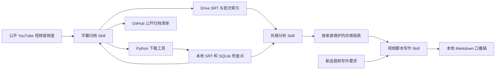

# 架构与数据流

## 模块边界

- `sources` 规范化 YouTube 视频和频道 URL。频道清单来自 Videos、Shorts、Live 标签，按视频 ID 去重。进行中的直播和预约内容跳过；已结束的回放进入常规归档。
- `download` 一次提取一个视频，用不同名称保存同语种人工字幕和原语言自动字幕。字幕转换为 SRT 并校验时间戳。下载仅产生字幕文件。yt-dlp 版本固定，更新时需复验字幕轨分类。
- `state` 把所有来源的尝试、待处理视频及已验证的 Drive 回执保存在同一个 `.state/`。进程锁禁止并行下载，SQLite 按滚动一小时计数，相邻尝试间隔至少 18 秒。单个工作区使用同一状态路径。429 优先遵循 Retry-After，未给出时暂停 15 分钟；以 exit 75 暂停，续跑遵守存盘的截止时间。
- `manifest` 提供私有上传队列、进度汇总及公开 CSV。公开行的字段为视频 ID、公开 URL、类别、语言、字幕类型和状态。视频级状态会区别无独立字幕、部分可取得、访问受限和失败。

## Skill 交接与存储

归档 Skill 从队列取本地 SRT，按频道和批次在 Drive 查找或创建目录。在视频 ID 目录中上传每条字幕，以 Drive MD5 或下载回读核对内容，再登记回执。重跑时优先复用同名且校验和一致的文件。批次索引随批次上传。公共 CSV 和 Google Drive 回执使用不同的输出命令与存储位置。

风格分析 Skill 读取本地 SRT 或 Drive 里的已归档字幕。分析结果由 Markdown 指南和 YouTube 视频时间戳组成。写稿 Skill 依赖选题和指南，归档服务不可用时也能用现有指南起稿。

Google Drive 路径为 `我的云端硬盘 / YouTube 字幕 / @频道 / batch-NNN / 视频ID`，批次目录保存 `index.csv`。字幕正文、账户凭据、Drive 私有文件 ID、工作状态和用户新写的稿件保留在私有或本地存储。
